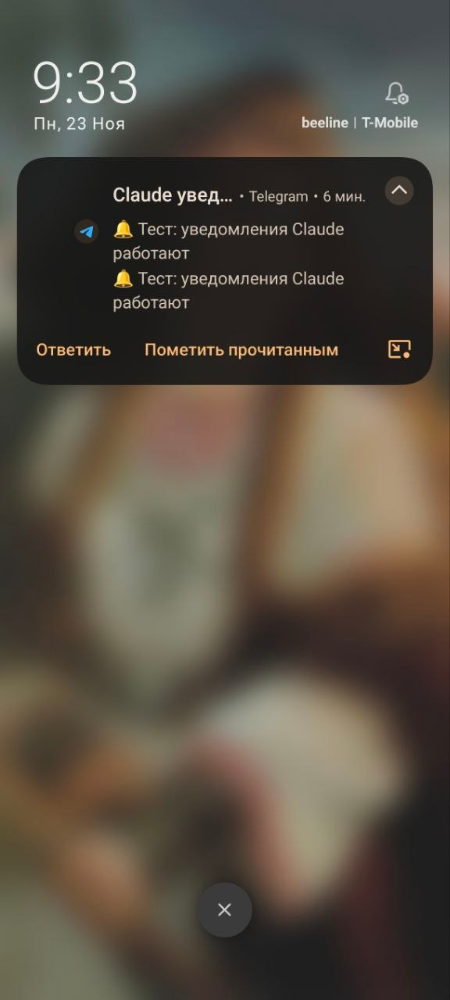
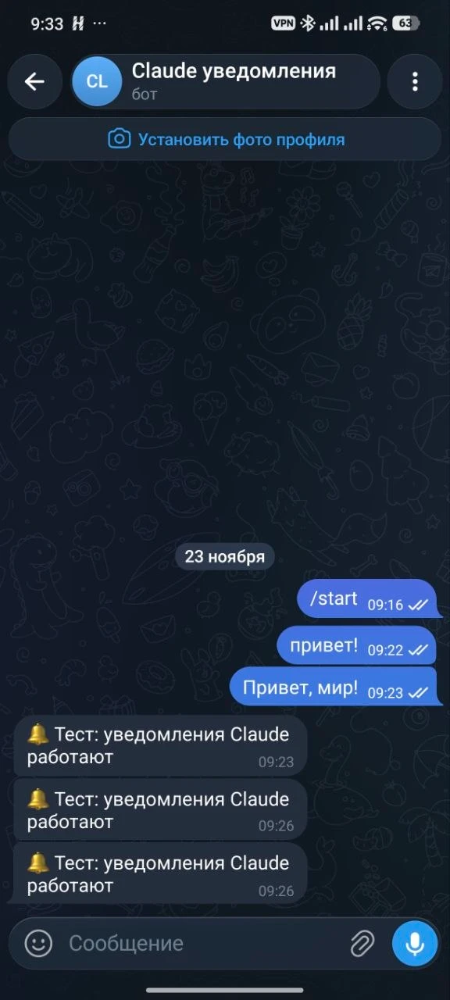

# claude-telegram-notify

Уведомления в Telegram от [Claude Code](https://claude.com/claude-code), **только когда тебя нет за компьютером**.

Дал Claude долгую задачу и ушёл обедать. Как только он закончил или ему нужен твой ответ, на телефон приходит сообщение от твоего бота. Пока сидишь за компьютером, бот молчит: ты и так всё видишь.

<p align="center">
  
  &nbsp;&nbsp;
  
</p>

Примеры сообщений:

```
✅ Готово · my-project

Собрал программу, запуск через start.cmd. Тесты проходят…
```
```
⚠️ Нужен твой ответ · my-project

Claude needs your permission to use Bash
```

## Как это работает

```
Claude Code ──(хук Stop / Notification)──► notify.ps1
                                              │
                         мышь и клавиатура трогались < N минут назад?
                              │ да                     │ нет
                          молчим               Telegram Bot API ──► 📱
```

- **Хуки Claude Code.** `Stop` срабатывает, когда Claude закончил ответ, `Notification` — когда ему нужно разрешение или ответ. Хук запускает скрипт и передаёт ему JSON с данными события.
- **Определение «отошёл».** Скрипт берёт время последнего ввода из WinAPI `GetLastInputInfo`. Если мышь и клавиатура не трогались дольше `idle_minutes`, ты считаешься отошедшим.
- **Текст уведомления.** Начало последнего ответа Claude: берётся из данных хука, а если его там нет — из файла переписки (JSONL).
- **Отправка.** `sendMessage` Telegram Bot API через `curl.exe`. Поддерживается прокси, включая `socks5h://`, если Telegram доступен только через VPN.
- **Без сервера и без зависимостей.** Нужны только PowerShell и curl, которые уже есть в Windows 10/11. Бот бесплатный.

## Установка

1. Создай бота у [@BotFather](https://t.me/BotFather) командой `/newbot` и скопируй токен.
2. Открой своего бота в Telegram и нажми **Start**.
3. Склонируй репозиторий и запусти `setup.cmd`. При первом запуске он создаст `config.json`.
4. Впиши токен в `config.json` и запусти `setup.cmd` ещё раз. Скрипт:
   - проверит токен;
   - найдёт твой `chat_id` по сообщению боту;
   - пропишет хуки в `%USERPROFILE%\.claude\settings.json`, не трогая остальные настройки (копия старого файла сохранится как `.bak`);
   - пришлёт тестовое сообщение.

Хуки начинают работать в новых сессиях Claude Code.

## Настройки (`config.json`)

| Поле | Что делает |
|---|---|
| `enabled` | `false` — временно выключить уведомления |
| `bot_token` | токен от @BotFather |
| `chat_id` | кому писать (setup заполняет сам) |
| `idle_minutes` | через сколько минут без мыши и клавиатуры ты считаешься отошедшим (по умолчанию 3) |
| `max_chars` | сколько символов ответа Claude показывать (по умолчанию 600) |
| `proxy` | прокси для Telegram, например `socks5h://127.0.0.1:10808` |

`config.json` с токеном лежит в `.gitignore` и в репозиторий не попадает. Каждое срабатывание и причина, почему сообщение отправлено или нет, пишутся в `notify.log`.

## Файлы

- `notify.ps1` — сам хук: проверка бездействия, сбор текста, отправка в Telegram.
- `setup.ps1` / `setup.cmd` — первичная настройка и регистрация хуков.
- `config.example.json` — шаблон настроек.

---

**English:** Telegram notifications from Claude Code that arrive only when you're away from the PC (no mouse or keyboard input for N minutes). It uses the Claude Code `Stop` and `Notification` hooks, WinAPI `GetLastInputInfo` and the Telegram Bot API. Pure PowerShell + curl, no server. Run `setup.cmd` to configure.

## Лицензия

MIT
